<p align="center">
  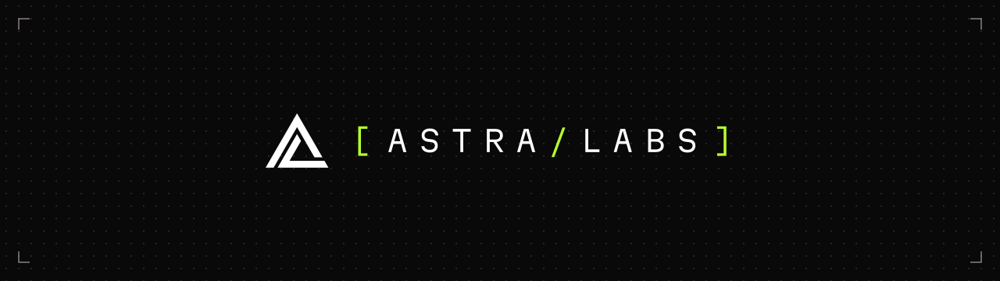
</p>

<p align="center">
  <a href="https://astralabs.dev"><b>astralabs.dev</b></a>
  &nbsp;·&nbsp;
  <a href="design-system.html">Design system</a>
  &nbsp;·&nbsp;
  <a href="web-kit.html">Web kit</a>
  &nbsp;·&nbsp;
  <a href="motion-lab.html">Motion lab</a>
  &nbsp;·&nbsp;
  <a href="LICENSE">AGPL-3.0</a>
</p>

<p align="center">
  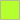
  
  
  
  
</p>

AstraLabs is the pseudo-brand Emily Astranova uses for her homelab, self-hosted services and the projects she shares, at [astralabs.dev](https://astralabs.dev).

This repo holds the brand assets, a drop-in stylesheet, React components, and three reference pages: the full design system, a web UI kit and a motion lab.

The look is a clean lab with a little hangar grit. It implements a futuristic UI of line markers, dot grids, small flickers to life and the occasional glitch.

---

## Contents

```
brand/
  astralabs-mark.svg            Mark, white (default)
  astralabs-mark-carbon.svg     Mark, carbon (for light surfaces)
  astralabs-lockup.svg          Mark + [ASTRA/LABS], horizontal
  astralabs-lockup-mono.svg     Lockup, single colour
  astralabs-lockup-stacked.svg  Lockup, stacked
  png/                          Mark at 32–1024px (white, carbon); lockups at 1200w / 2400w
  square/                       Square icons for Discord etc. (plain and registration-grid), 128–1024px
  fonts/                        Martian Mono variable font + OFL licence
  astralabs.css                 Drop-in stylesheet: tokens, type, components, utilities
  astralabs-components.js       React components (window.AstraLabs)
  astralabs-components.d.ts     Type definitions for the components
design-system.html              Full brand guide, tokens, logos, live components, motion (one file)
web-kit.html                    Interactive UI kit
motion-lab.html                 Motion system reference and concepts
.github/assets/                 README banner and colour swatches
LICENSE                         GNU AGPL-3.0
```

All lockup SVGs have their text converted to outlines, so they need no fonts.

---

## Brand essentials

### Mark

- The mark is **always solid white** on dark surfaces. Use `astralabs-mark-carbon.svg` only on light surfaces.
- Never split it into two colours, and never tint it Acid.
- Geometry (viewBox `0 0 600 519.62`) is two paths built on a 60° triangle. The two negative-space gaps are equal width.
- Keep clear space of at least the width of one gap around it.

To use it inline, define it once as a `<symbol>` with `fill="currentColor"` and set `color` on the `<svg>`. Classes on the `<use>` element don't reach the paths inside it.

```html
<svg width="0" height="0" style="position:absolute">
  <symbol id="al-mark" viewBox="0 0 600 519.62" fill="currentColor">
    <path d="M0 519.62 L300 0 L542.84 420.62 L466.63 420.62 L300 132 L76.21 519.62 Z"/>
    <path d="M114.32 519.62 L300 198 L338.11 264 L228.63 453.62 L561.89 453.62 L600 519.62 Z"/>
  </symbol>
</svg>
<svg width="32" height="28" style="color:#fff"><use href="#al-mark"/></svg>
```

### Wordmark: Bracketed Path

The wordmark is `[ASTRA/LABS]`. It is set in Martian Mono at weight 300, width 112.5, with .36em tracking. The brackets and slash take the same weight as the letters.

### Colour

| Token | Hex | Role |
|---|---|---|
|  `--void` | `#0A0909` | Carbon background |
|  `--plate` | `#131212` | Raised surfaces, panels |
| 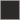 `--rule` | `#2C2A29` | Borders, dividers |
|  `--rule-subtle` | `#1C1B1A` | Grid lines, dot grids |
|  `--mark` | `#FFFFFF` | The mark only |
|  `--bone` | `#EDE6E1` | Accent, primary text |
|  `--ash` | `#8E8380` | Secondary text, labels |
|  `--acid` | `#B6FF2E` | Primary: actions, focus, live data |
| 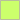 `--acid-hi` | `#CCFF6B` | Acid hover |
| 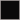 `--on-acid` | `#0A0909` | Text on Acid |
| 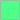 `--status-ok` | `#4DFF88` | Status: healthy |
| 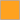 `--status-warn` | `#FFA21F` | Status: degraded |
| 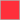 `--status-down` | `#FF2E3A` | Status: down / danger |

Use Acid sparingly, for one primary action or one live signal per view. The status colours are reserved for state. Always pair them with a label and never reuse them as decoration.

### Chart palette

| Token | Hex |
|---|---|
| 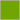 `chart-1` | `#70A600` |
|  `chart-2` | `#0486D3` |
| 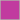 `chart-3` | `#C13B9F` |
| 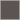 `chart-other` | `#5A5452` |

Single-series charts use Acid. Multi-series charts take the chart colours in fixed order. Anything past three series folds into `chart-other`. The palette has been checked for colour-vision-deficiency separation.

### Typography

| Role | Face | Notes |
|---|---|---|
| Display, body | Archivo | Loaded from Google Fonts |
| Labels | Martian Mono | 10.5px, uppercase, .14em tracking |
| Data, readouts | Martian Mono | Tabular figures |
| Wordmark | Martian Mono | 300 weight, wdth 112.5, .36em tracking |

### Geometry

- **The angle is 60°.** It comes from the mark, and every cut, hazard stripe and slash uses it.
- **One cut per view.** Chamfered corners (`--chamfer-sm` 9px, `--chamfer-md` 22px) are only for filled primary buttons and the danger dialog. Everything else is square.
- **No tilts.** Decals, stamps and tags sit level.
- **Detail comes from line markers and dot grids**: tick rules, leader lines, registration marks, serial and asset tags. Keep gauges simple.

---

## Motion

Things in this system power on rather than slide in. Hard cuts and flickers are the signature, and smooth easing is kept for things that settle.

### Speeds

| Token | Duration | Easing | Use |
|---|---|---|---|
| Flick | 40ms | `steps` | Flicker frames, hard cuts |
| Snap | 200ms | `cubic-bezier(.3,1.35,.5,1)` | Toggles, brackets locking, column pushes |
| Settle | 360ms | `cubic-bezier(.16,1,.3,1)` | Rescales, panels coming to rest |
| Trace | 900ms | `cubic-bezier(.7,0,.2,1)` | Outlines and the mark being drawn |

### Patterns

- **Strobe-in** (340ms): only for things powering on.
- **Wipe-in** (560ms): only for lines and rules.
- **Stagger** (60ms step): fade and rise, for lists.

Working UI has **no entrance animations**. Content is simply there, ready to read. Motion is kept for boot sequences, state changes and live data.

For stepped flickers in WAAPI, put `steps(1, end)` on **each keyframe**. Don't use it as the easing of the whole animation, or the flicker renders as blank and then instant.

### Login sequence

1. **Dot field ignition.** The grid sits still for a moment, then lights up outward from the centre.
2. **Sea idle field.** The dots stay still. Slow patterns of slightly different greys (about ±14%) drift across them, like ocean swells seen from above.
3. **Mark.** The outline traces, then the fill flickers on like a tube.
4. **Path boot.** `[ / ]` shows with a spinner. `ASTRA` types in on the left, then `LABS` on the right, then the brackets snap shut.
5. **SSO handoff** (auth.astralabs.dev). Panes flicker out and flicker back in.

There is no radial glow, no crosshair guides and no decorative readout text.

### Glitch

An idle glitch fires every 8 to 20 seconds. It is a canvas engine with five layers:

- RGB chromatic split, kept subtle
- line shift
- block tear
- jitter
- dropout

Intensity can be adjusted. Keep it rare and brief.

---

## Usage

### Stylesheet

Copy `brand/astralabs.css` and `brand/fonts/` next to each other. The stylesheet loads Martian Mono from `fonts/MartianMono-Variable.woff2` and Archivo from Google Fonts.

```html
<link rel="stylesheet" href="astralabs.css">

<body class="al-surface">
  <h1 class="headline-xl">Services</h1>
  <button class="al-btn al-btn-primary">Deploy</button>
  <div class="al-panel al-dots">…</div>
</body>
```

The stylesheet provides three groups:

- **Token variables** on `:root`, for example `var(--acid)` and `var(--space-4)`.
- **Type classes**, such as `.headline-xl`.
- **Component classes**, all prefixed `.al-*`. Its utilities include:

| Utility | Effect |
|---|---|
| `.al-ticks` | Tick-mark rule |
| `.al-dots` | Dot-grid background |
| `.al-mrule` | Marker rule |
| `.al-leaders` | Leader lines |
| `.al-enter`, `.al-power`, `.al-light` | Opt-in motion helpers for boot screens |

### React components

```html
<script src="https://unpkg.com/react@18.3.1/umd/react.production.min.js"></script>
<script src="https://unpkg.com/react-dom@18.3.1/umd/react-dom.production.min.js"></script>
<script src="astralabs-components.js"></script>
<script>
  const { Lockup, Button, Panel, StatusPill } = window.AstraLabs;
</script>
```

The components:

- **Brand:** `Mark`, `Wordmark`, `Lockup`
- **Controls:** `Button`, `FocusFrame`
- **Display:** `Panel`, `Readout`, `StatusPill`, `Dial`, `Terminal`
- **Decals:** `HazardBand`, `SerialTag`, `AssetTag`

Types are in `astralabs-components.d.ts`.

---

## Reference pages

**`design-system.html`** is the complete design system in one file: the brand guide, every colour, type, spacing and chamfer token with its usage, the logo files, live previews of each component with its usage notes, and the full motion spec. The Martian Mono font is embedded in it.

Open these pages directly in a browser. They need no build step.

**`web-kit.html`** is the full component library. It covers:

- login and SSO
- terminal
- app shell
- actions and forms
- data tables and live log
- feedback, navigation and page templates

Its graphs section includes:

- live CPU with a threshold
- request columns
- network rx/tx
- storage
- memory stack
- latency histogram
- 90-day uptime

**`motion-lab.html`** covers:

- the 5.1s reboot intro storyboard
- the dot field idle states
- motion profiles plotted as curves
- Strobe-in, Wipe-in and Stagger
- the glitch anatomy, with controls
- graphs in motion
- a set of motion concepts, including registration align and level decal stamps

---

## Licence

Copyright © 2026 Emily Astranova.

The AstraLabs design and brand, including the name, mark, wordmark, lockups and visual identity, are the work of Emily Astranova and are copyrighted by her.

This project is licensed under the [GNU Affero General Public License v3.0](LICENSE) (AGPL-3.0). The AGPL grants no trademark rights: the AstraLabs name and logos identify Emily Astranova's work and shouldn't be used to brand anything else.

Martian Mono is © Evil Martians and is licensed separately under the SIL Open Font License 1.1 (`brand/fonts/OFL.txt`). Archivo is also licensed under the OFL and is served by Google Fonts.
